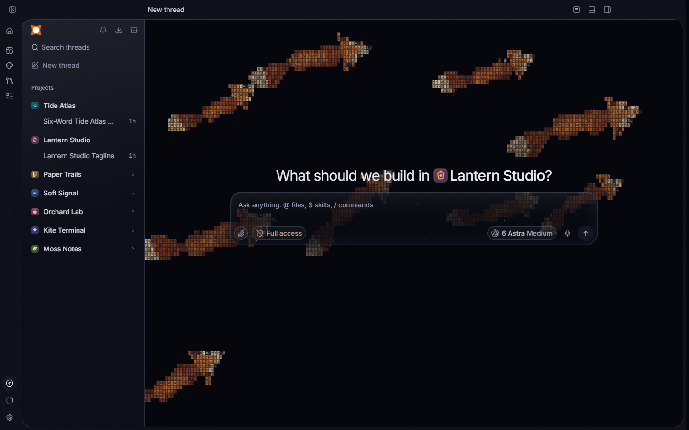
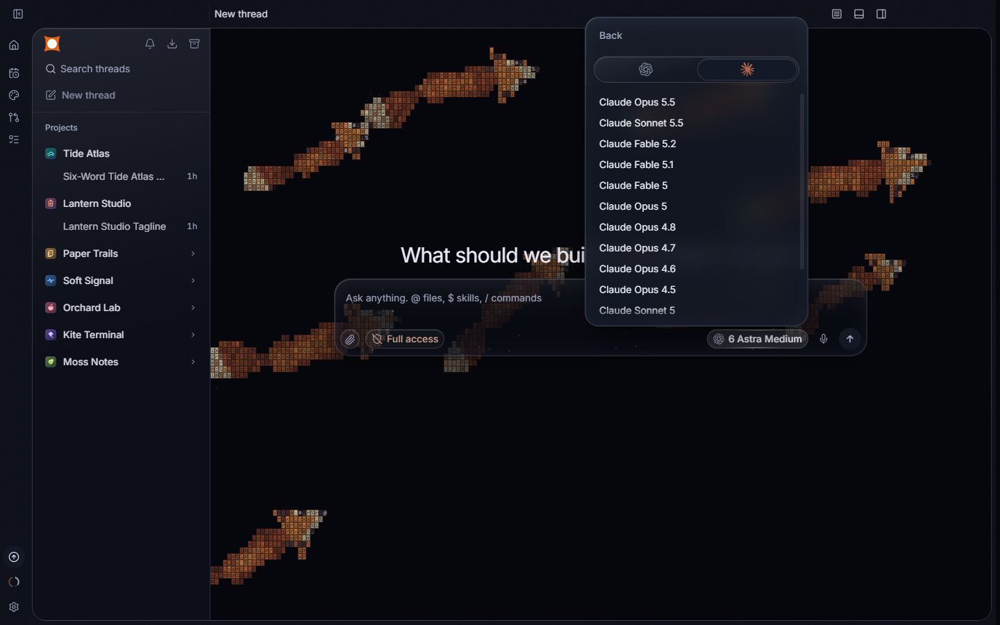
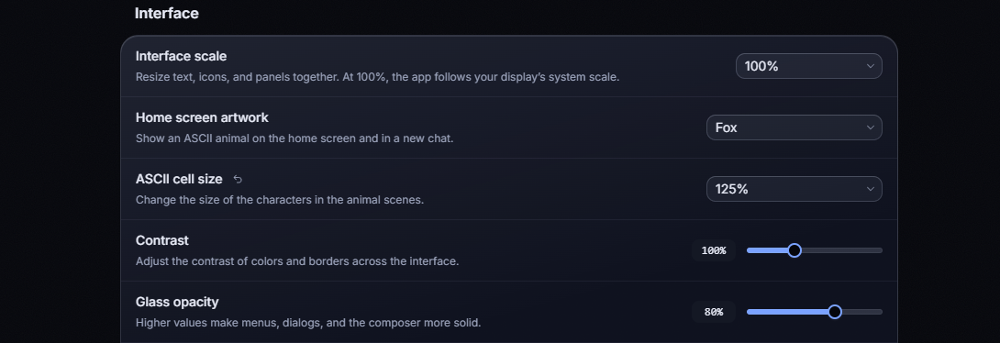

# T3 Codex

A desktop fork of T3 Code by redheadesign for working with Codex, Claude Code, and other coding agents. It adds a glass interface, interactive ASCII animals, and a Codex-style project sidebar with task boards and a design canvas.

**[Download for macOS, Windows, or Linux](https://github.com/redheadesign/t3code-codex/releases/latest)** · [Browse releases](https://github.com/redheadesign/t3code-codex/releases)



## Highlights

- **Interactive ASCII scenes.** Pick from foxes, manta rays, sea turtles, octopuses, goldfish, and dolphins. Nearby animals steer around the pointer and turn away from a background click.
- **Glass workspace.** The composer, model picker, and thread details share the glass styling. Adjust the opacity in **Settings → Appearance**.
- **Independent sizing.** Scale the desktop interface and adjust character size in the ASCII scenes separately.
- **Project tools.** Organize threads by project, track work on task boards, and explore ideas on the design canvas.

## Screenshots

### Model picker



### Appearance settings



The screenshots show a demo workspace.

## Install and sign in

1. Pick the installer for your operating system and processor from the latest release. [Latest release](https://github.com/redheadesign/t3code-codex/releases/latest)
   - **macOS:** Open the Apple Silicon or Intel `.dmg` and drag the app to **Applications**. Install updates manually from Releases.
   - **Windows:** Run the x64 or ARM64 `.exe`.
   - **Linux:** Use the x64 or ARM64 AppImage or install the matching `.deb` on Debian-based distributions.
2. Sign in to at least one coding agent with your provider account. [Codex setup](docs/user/providers-codex.md) · [Claude Code setup](docs/user/providers-claude.md)

## Documentation

- [Threads and projects](docs/user/thread-sidebar.md)
- [Project settings](docs/user/project-settings.md)
- [Keyboard shortcuts](docs/user/keybindings.md)
- [Remote access](docs/user/remote-access.md)
- [Connect external agents through MCP](docs/user/outside-agents.md)
- [All documentation](docs)

## Build from source

### Install vp

Install the `vp` CLI, then run the following commands from the repository root. [Vite+ installation guide](https://www.viteplus.dev/guide/)

```sh
vp i
vp run dev
```

Open the pairing URL printed by the dev runner. [Development guide](docs/operations/development.md)

### Build desktop installers

Run the desktop release workflow with a version and platform. GitHub Actions launches the packaged apps against an isolated profile and uploads the installers and checksums. Select **All** and enable **Publish** on `main` to publish the verified builds as a GitHub Release. [Desktop release workflow](https://github.com/redheadesign/t3code-codex/actions/workflows/personal-desktop.yml) · [Releases](https://github.com/redheadesign/t3code-codex/releases)

## Credits and license

Based on the open-source [T3 Code](https://github.com/pingdotgg/t3code). The animated scenes draw on [ASCII Animals from Pocket Studio](https://www.pocketstudio.design/ascii-animals-app/index.html).

[MIT License](LICENSE)
